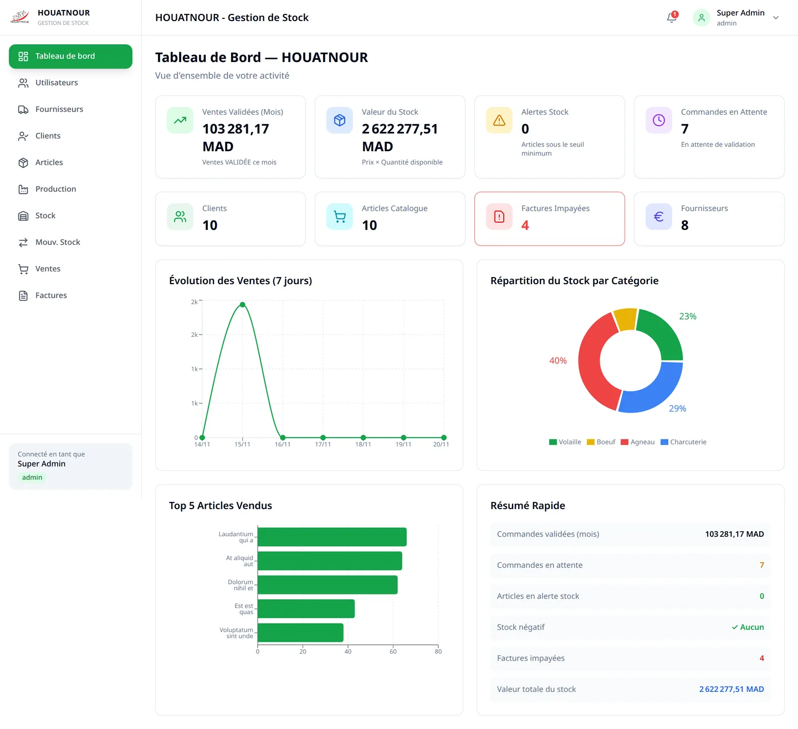
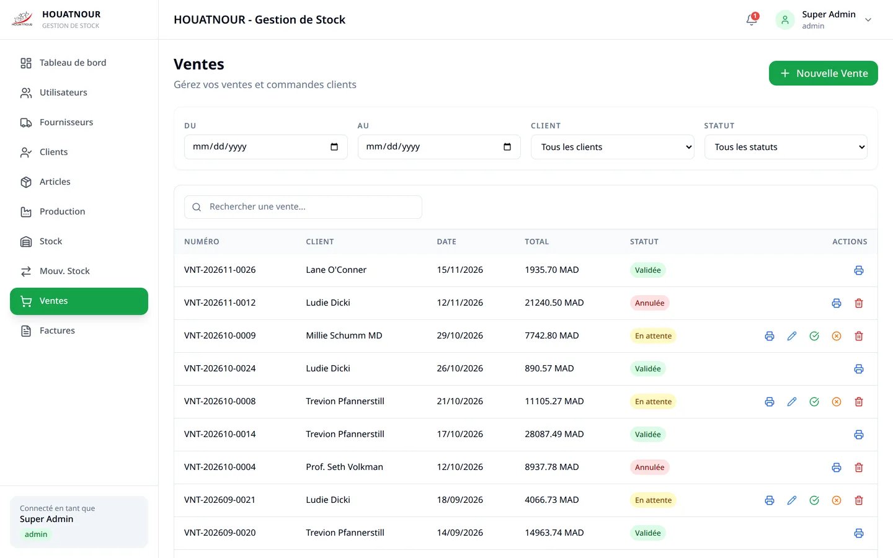
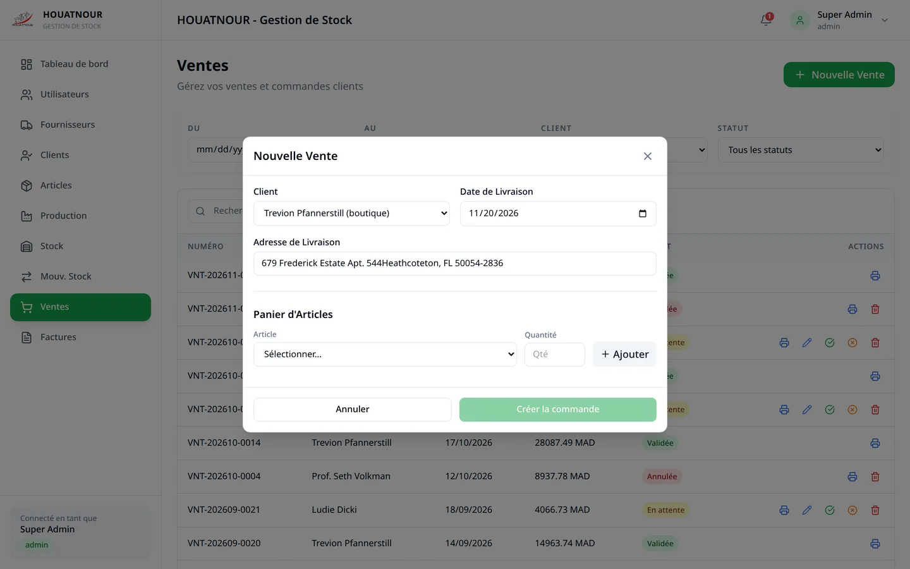
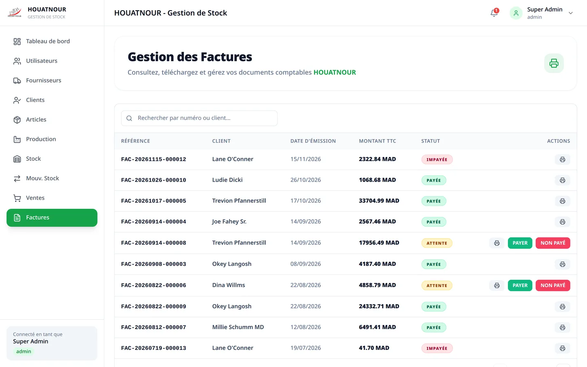
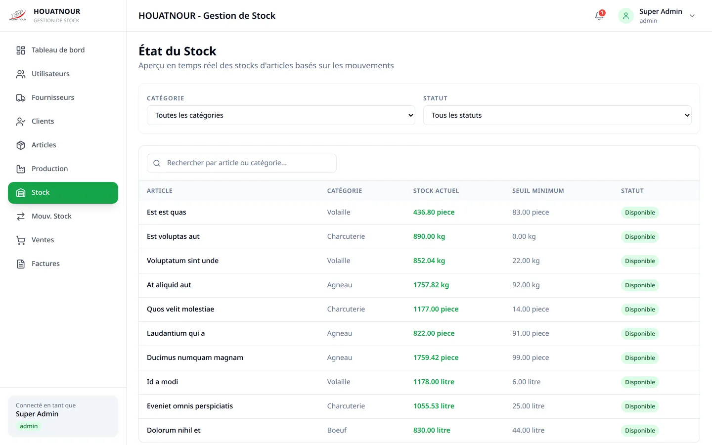
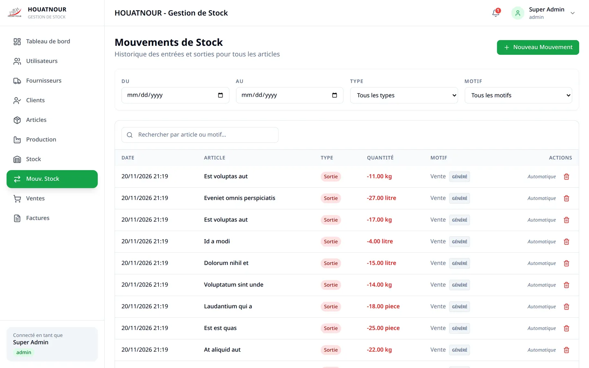
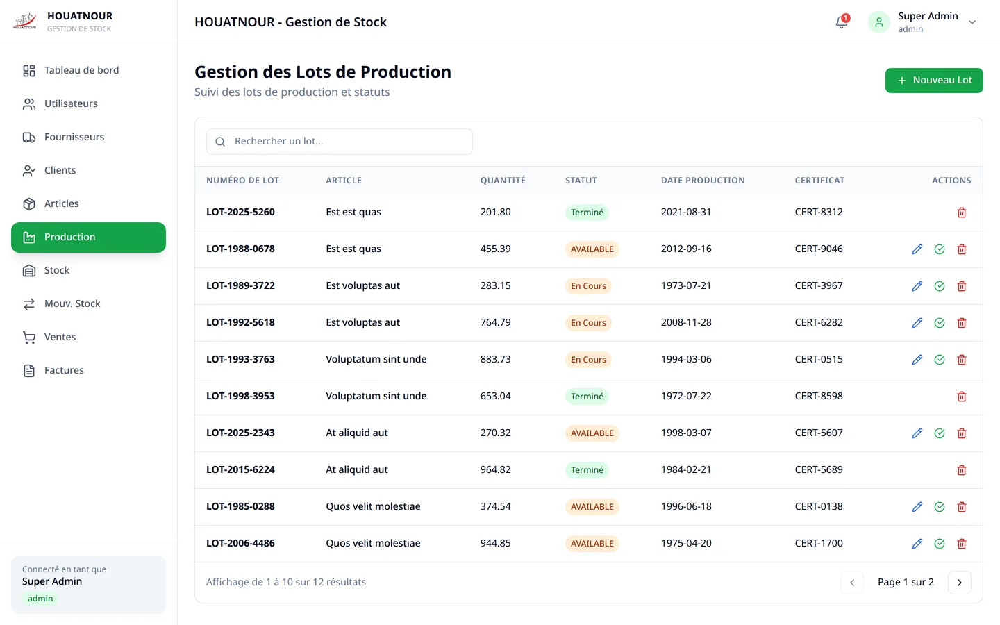
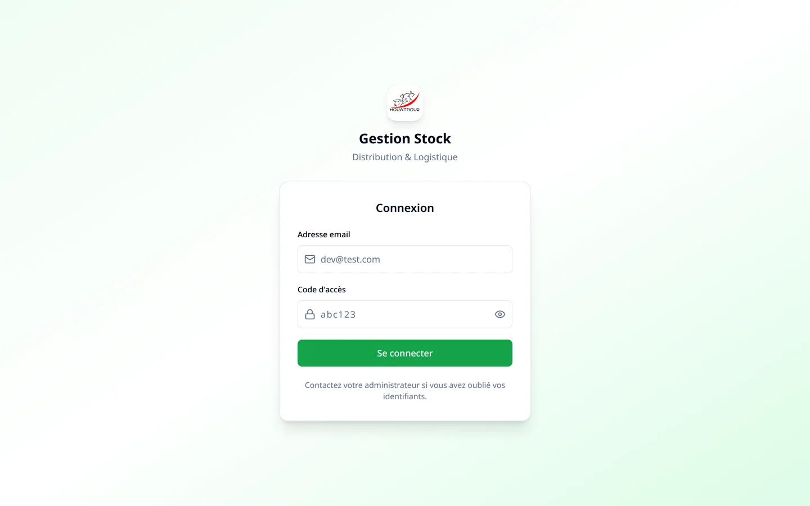
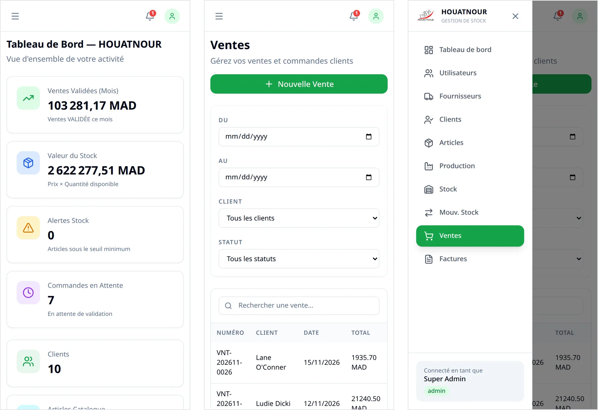

# HOUATNOUR: Gestion de Stock

A full-stack stock and sales management app for HOUATNOUR, a halal meat distributor (poultry, beef, lamb and cured meats). The team tracks production lots, stock levels, customers, suppliers, sales and invoices from one place, and each employee sees only the parts their role needs.

The app is in French, amounts are in Moroccan dirhams (MAD), and it works on phones as well as desktops.



> The demo data is fake: names, prices and quantities are generated by the seeders.

## Features

**For every role**

- Login with an e-mail and a personal access code. The session ends after 12 hours, and an expired session goes straight back to the login page.
- A sidebar showing only the pages your role can open, and in-app notifications.
- Tables with search and pagination on every list.

**Sales and invoices** (admin and sales staff)

- Clients: create, edit and delete, with their delivery address.
- Sales with several articles per order, filters by date, client and status, and a total computed from the lines.
- A sale moves from `En attente` to `Validee` or `Annulee`. Validating takes the items out of stock and creates the invoice in one step. If one article lacks stock, nothing changes.
- Invoices with 20% VAT, marked paid or unpaid, and printable from the browser.

**Stock and production** (admin and stock staff)

- Articles with a reference, unit, category, price and minimum stock level.
- Live stock per article, flagged `Disponible`, `Faible` or `Rupture`.
- Stock movements in and out. Movements created by sales and production are read-only, and a movement that would make stock negative is refused.
- Production lots with their slaughter certificate. Completing a lot adds its quantity to stock.

**Administration** (admin only)

- A dashboard with the month's validated sales, stock value, stock alerts, pending orders, unpaid invoices and charts.
- Users with three roles (`admin`, `ventes`, `stock`), deactivation instead of deletion, and a guard so the last admin can't be demoted.
- Suppliers.

**The API**

- A REST API with Bearer tokens (Laravel Sanctum) and role checks on every route.
- Access codes are hashed, inactive accounts are refused, and login attempts are rate-limited.
- Stock rows are locked while they change, so quantities and statuses always match the movements.
- Records that are part of the history (clients or articles with sales, and so on) can't be deleted.
- 61 feature tests, run by GitHub Actions on every push with a code-style check and a dependency audit.

## Screenshots

| Sales | New sale |
|---|---|
|  |  |
| **Invoices** | **Stock** |
|  |  |
| **Stock movements** | **Production lots** |
|  |  |
| **Login** | |
|  | |

On phones:



## Tech stack

| Part | Built with |
|---|---|
| Frontend | React 18, Vite 6, React Router 6, axios, Tailwind CSS 3, Radix UI, Recharts, lucide-react |
| Backend | PHP 8.3+, Laravel 13, Laravel Sanctum (Bearer tokens) |
| Database | MySQL 8 or MariaDB 10.6+ (SQLite in memory for the tests) |
| Tests and tools | Pest / PHPUnit, Laravel Pint, Composer audit, GitHub Actions |

## How it's organised

```
backend/     The Laravel API: auth, roles, stock, production, sales, invoices
front-end/   The React app
.github/     The CI workflow for the backend
docs/        The screenshots in this README
```

The backend has its own README with the details:

- [backend/README.md](backend/README.md): configuration, roles, every endpoint, business rules and production deployment
- [backend/PRODUCTION_AUDIT.md](backend/PRODUCTION_AUDIT.md): the issues found and fixed before production

## Run it on your computer

You need PHP 8.3 or newer, Composer, MySQL or MariaDB, and Node.js 20 or newer.

**1. The backend**

Create an empty MySQL database, then:

```bash
cd backend
composer setup                 # installs, creates .env and the app key, runs the migrations
```

In `backend/.env`, set `DB_DATABASE`, `DB_USERNAME` and `DB_PASSWORD` for your database. If `composer setup` couldn't migrate, run `php artisan migrate`. Then:

```bash
php artisan db:seed            # the admin account and the demo data
php artisan serve              # the API on http://localhost:8000
```

The seeders fill every table: users, articles and their stock, suppliers, clients, production lots, stock movements, and 30 sales spread over the last six months with their lines and invoices.

**2. The frontend**, in a second terminal:

```bash
cd front-end
npm install
npm run dev                    # the app on http://localhost:5173
```

The frontend expects the API at `http://localhost:8000/api`.

**Demo accounts**

| Account | E-mail | Access code |
|---|---|---|
| Admin | `admin@example.com` | `Admin1234` |
| Sales or stock staff | any seeded user (see the Utilisateurs page) | `Code1234` |

Change the admin e-mail and code with `ADMIN_EMAIL` and `ADMIN_ACCESS_CODE` in `backend/.env` before seeding.

**Reset or add demo data**

```bash
php artisan migrate:fresh --seed          # deletes everything and seeds again
php artisan db:seed --class=SaleSeeder    # adds 30 more sales without deleting anything
```

**Checks**

```bash
cd backend && php artisan test && vendor/bin/pint --test && composer audit
cd front-end && npm run build
```

## Production

Production uses its own template, `backend/.env.production.example`. The seeders create only the admin there, never demo data. The full checklist is under "Production deployment" in [backend/README.md](backend/README.md).
